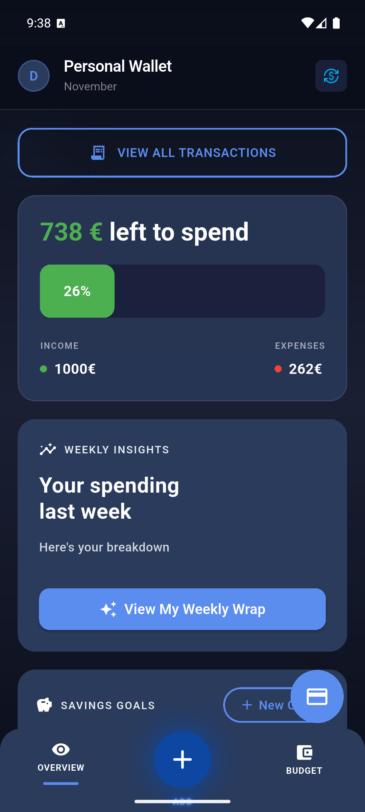
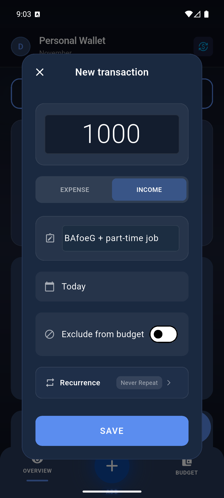
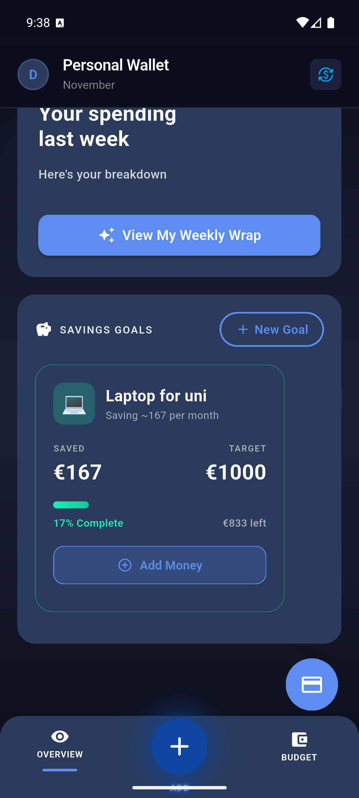
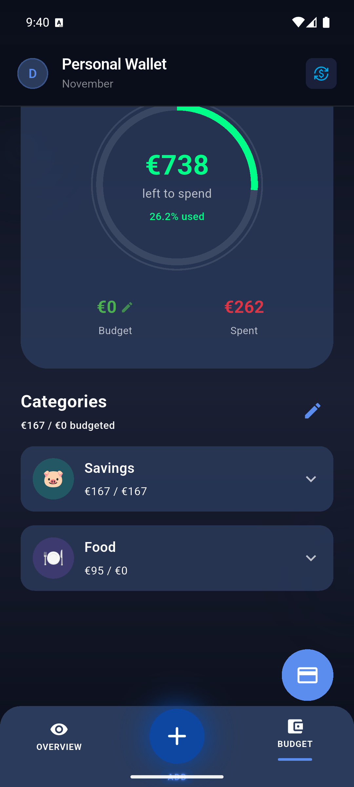
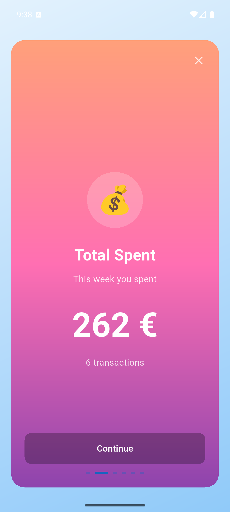
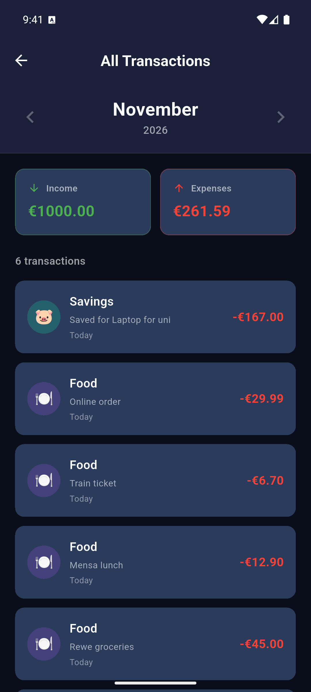
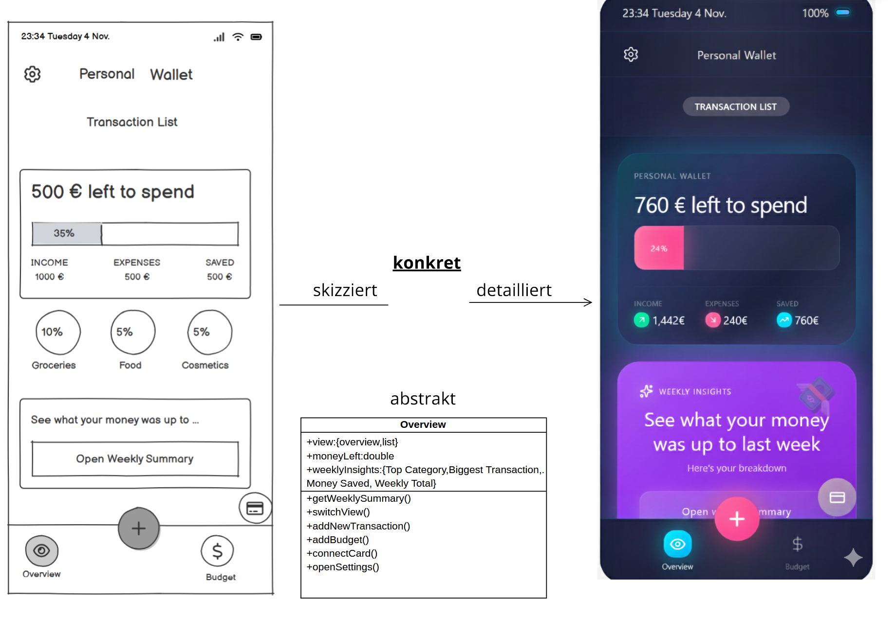
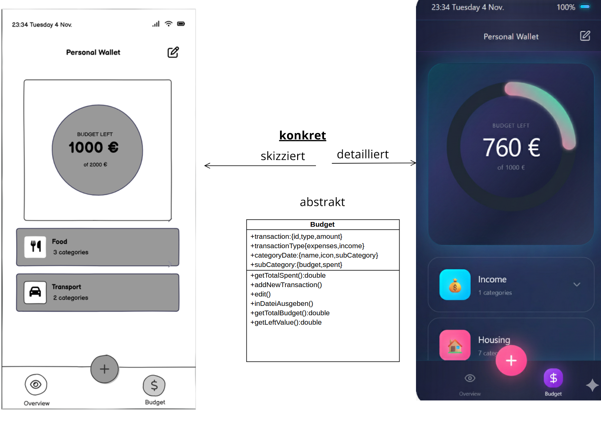
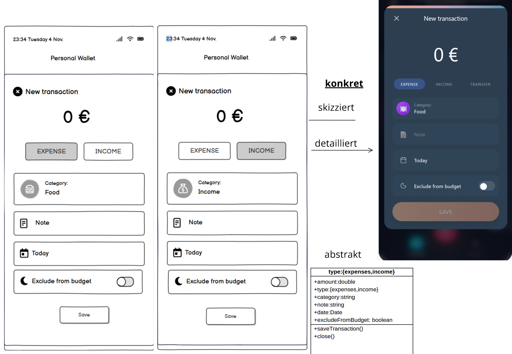
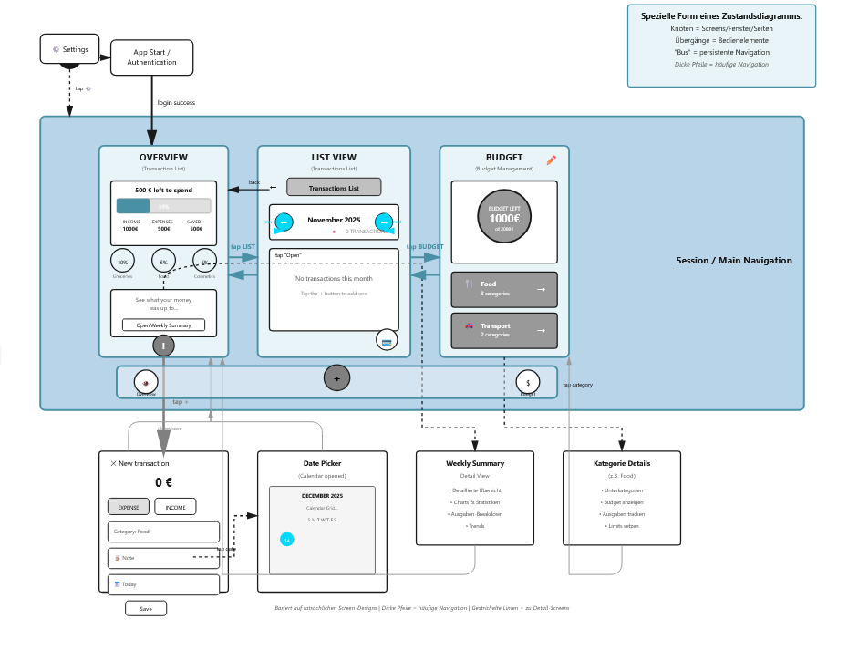

# SmartSpend

**An "anti-splurge" budgeting app for 18–28-year-olds: it shows how much you can safely spend right now, separates rent and savings from fun money, and gives you a weekly wrap-up instead of nagging. Offline-first Flutter, no bank login required.**

[](https://github.com/loatsoat/budgeting_app/actions/workflows/ci.yml)


## Why

One in five 14–29-year-olds in Germany is in debt, a record high ([ZDF, 2025](https://www.zdfheute.de/wirtschaft/verschuldung-junger-menschen-rekord-100.html)). Students and trainees live on small, irregular income (BAföG, part-time jobs) while one-tap shopping, social-media trends and "buy now, pay later" make impulse spending effortless. Existing banking apps manage money; they don't help change behaviour, and the ones we looked at felt formal and demotivating.

SmartSpend was built for that group as a team project in the Human-Computer Interaction course at Hochschule Darmstadt (WS 25/26). It went from user research through paper prototypes to a working Flutter app, and was evaluated with real users at each stage (see [How we validated it](#how-we-validated-it)).

## Screenshots

Running on an Android emulator (Pixel 7, Android 16) with made-up demo data.

| Overview | Add transaction | Savings goal |
|---|---|---|
|  |  |  |

| Budget | Weekly wrap | Transactions |
|---|---|---|
|  |  |  |
## From sketch to design

Each main screen was designed at three levels: a hand-drawn sketch (left), a UML-style model of its state and actions (middle, "abstrakt"), and a detailed high-fidelity mockup (right). The sketches were tested as paper prototypes before any code was written.

**Overview.** The "left to spend" number leads, with income, expenses and savings below it and the weekly wrap-up one tap away.



**Budget.** Ring chart of what's left, with categories and subcategories underneath.



**Add transaction.** A modal kept to the fewest possible fields so an entry fits into a few seconds.



**Navigation map.** Main screens share a persistent bottom bar; dashed lines lead to detail screens.



## Features

| Area | What it does |
|---|---|
| Budgets | Per-category limits with subcategories; circular chart shows used vs. remaining |
| Transactions | Manual entry, recurring transactions (weekly → yearly), auto-suggested category |
| Savings goals | Target amount + deadline, computed monthly contribution, progress tracking |
| Insights | Overspending alerts, month-over-month trends, weekly wrap-up |
| Currency | Live EUR rates and converter via [frankfurter.app](https://www.frankfurter.app) (no API key) |
| Accounts | Local multi-user login with security-question recovery |

## Quick start

**Prerequisites:** Flutter **3.35.x** (Dart **3.9+**). Check with `flutter --version`.

```bash
git clone https://github.com/loatsoat/budgeting_app.git
cd budgeting_app
flutter pub get
flutter run            # pick a device: Android, iOS, Windows, macOS or Linux
```

Web is not supported: the SQLite backend (`drift/native`) needs `dart:ffi`, which browsers don't provide. A desktop build also needs that platform's toolchain (on Windows: Visual Studio with "Desktop development with C++"); `flutter doctor` tells you what's missing.

You should land on the login screen. Create an account to get to the budget overview.

The generated Drift code (`lib/data/database.g.dart`) is committed, so no code generation is needed. If you change `lib/data/database.dart`, regenerate it:

```bash
dart run build_runner build --delete-conflicting-outputs
```

## Tests

```bash
flutter test
flutter analyze --no-fatal-infos   # same check CI runs
```

| Suite | Covers |
|---|---|
| `test/services/expense_categorizer_test.dart` | Category prediction, confidence scores, fallbacks, case handling (15 tests) |
| `test/services/budget_ledger_test.dart` | Spent totals and savings goals on add/edit/delete, recurring occurrences, monthly income (10 tests) |
| `test/widget_test.dart` | App boots and renders the root widget |

CI runs analyze and tests on every push ([.github/workflows/ci.yml](.github/workflows/ci.yml)).

## Architecture

```
            ┌──────────────────────────┐
            │  screens/  widgets/      │  UI (StatefulWidgets, dialogs)
            └────────────┬─────────────┘
                         │ listens / calls
            ┌────────────▼─────────────┐
            │  services/               │  business logic
            │  BudgetLedger            │  spent totals, goal balances, recurrence
            │  SpendingRecommendations │  rule-based insights
            │  ExpenseCategorizer      │  keyword scoring → category + confidence
            │  ExchangeRateService     │  HTTP → frankfurter.app
            │  SimpleAuthManager       │  login / session
            └──────┬──────────────┬────┘
                   │              │
     ┌─────────────▼───┐   ┌──────▼──────────────┐
     │ SharedPreferences│   │ SQLite via Drift    │
     │ budgets, goals,  │   │ users table         │
     │ transactions JSON│   │ (lib/data/)         │
     └─────────────────┘   └─────────────────────┘
```

```
lib/
├── main.dart              # entry point, theme, auth wrapper
├── data/                  # Drift schema + generated code
├── models/                # Transaction, SavingsGoal, ExchangeRate …
├── services/              # logic layer (see diagram)
├── screens/               # one folder per feature: auth, budget, bank, overview, settings
├── widgets/               # reusable UI + feature dialogs
├── themes/app_theme.dart  # colour tokens, dark theme
└── utils/                 # constants, debug DB admin screen
test/                      # unit + widget tests
```

## How we validated it

| Stage | Method | What it changed |
|---|---|---|
| Research | Semi-structured interview with a student from the target group (critical-incident, metaphor and card-sorting techniques); personas built from a 12-person criteria matrix | Defined the core features below |
| Prototype | Paper prototype, 4 task-based tests with 2 target-group participants, no hints given | Added a dedicated savings-goal button, category suggestions and clearer feedback after adding a transaction |
| Working app | Thinking-aloud test of first-time use on an Android tablet, followed by an interview | Found the issues listed under [Known limitations](#known-limitations) |
| Peer review | Nielsen-heuristic usability inspection and a design review by another course team | Same as above, plus small touch targets and inconsistent colour use |

The sample sizes are small (course scope), so these are directional findings, not statistics.

## Design decisions

### Product and UX (from user research)

**A "left to spend" number front and centre.** The interviewee said what they wanted to see first thing in the morning was "how much I can safely spend today". The overview screen leads with that number, after fixed costs and savings are taken out, instead of a list of transactions.

**Weekly wrap-up, not daily or monthly.** Daily notifications were described as "too easy to ignore" and monthly reports as "too late to change anything". A weekly, story-style summary was the explicit preference, and test users described it as "very helpful".

**Separate untouchable money from flexible money.** Users think in pots and worry about accidentally spending rent. Savings goals are deducted from the flexible budget up front, so day-to-day spending can't eat into them.

**Neutral rather than judgmental.** The goal was "spend without feeling guilty later". Red in the charts means *spent*, not *alarm*. Trade-off: the app still shows a "budget exceeded" state, and a test user said that red label "scares me a bit", so it is a candidate for softening.

**Bottom navigation and a floating add button.** These keep the main screens and the most frequent action (logging a purchase) within thumb reach, because entries have to fit into a few seconds at the till. In testing, every participant found the add button immediately.

### Engineering

**Offline-first, no backend.** Financial data is sensitive and a course project can't responsibly operate a server holding it. Keeping everything on-device removes a whole class of security and privacy problems and makes the app usable without connectivity. Trade-off: no sync between devices.

**Drift for users, SharedPreferences for budget data.** User accounts need uniqueness constraints and lookups, which a typed SQL schema handles well; Drift gives compile-time-checked queries over raw `sqflite` strings. Budget state is a small document that is always read and written as a whole, so serialising it as JSON was simpler than modelling every entity relationally. Trade-off: transaction history won't scale to years of data without moving it into SQLite too.

**Keyword scoring instead of an ML model for categorisation.** A trained model would need labelled data we didn't have and would be opaque to users. Keyword matching is predictable (a description containing *starbucks* always lands in Food & Dining), runs instantly with no model download, returns a confidence score the UI shows next to the suggestion, and is easy to unit-test.

**Rule-based recommendations.** Same reasoning: users should be able to see *why* the app says they're overspending. Rules compare category spend against the limit and the previous month.

**Screen-owned state, bookkeeping in a plain class.** The budget screen (`BudgetApp`) owns the app state and hands it to child screens through constructor arguments and callbacks, without Bloc/Riverpod, which the team hadn't all used. The part that has to stay consistent (category totals, savings-goal balances, recurring occurrences) lives in `BudgetLedger`, which has no widget dependencies and is unit-tested.

**Errors surface, they don't crash.** Network calls (exchange rates) and storage reads are wrapped and rethrown with context; the exchange-rate widget renders an explicit error state instead of failing silently.

## Known limitations

- Passwords are hashed with unsalted SHA-256. Fine for a local demo; a real release should use a salted KDF (e.g. Argon2/PBKDF2) and platform secure storage.
- Bank connection is a UI prototype with simulated data, not a real banking API.
- Bugs found during a manual run: a savings contribution rounded up from the computed monthly rate (e.g. €167 vs. €166.67) triggers a red "budget exceeded by €0.33" alert; the weekly wrap counts savings deposits as spending; "Budget = Income" can leave the total budget at €0; the "Create Savings Goal" title overflows on a 1080 px-wide phone; the login and sign-up screens mix German and English labels.
- Open findings from usability testing: tablet landscape layout breaks (orientation isn't locked or adapted), there's no undo after deleting an entry, and there's no first-run tutorial explaining "budget" vs. "income".

## Team

HCI WS 25/26, Group 04. See the commit history for individual contributions.

## License

[MIT](LICENSE)
